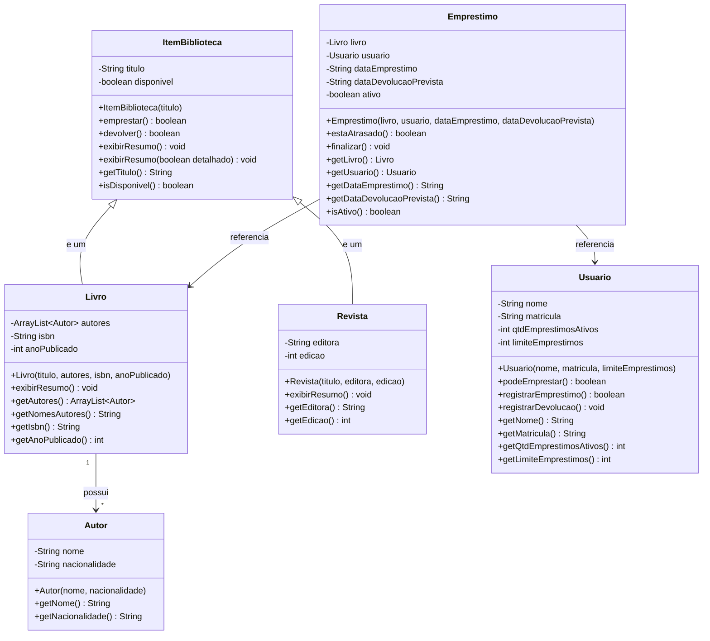

# Modelagem — Domínio Biblioteca (Grupo 1) — Etapa 3

## Hierarquia (herança)

```
ItemBiblioteca  (superclasse)
    │
    ├── Livro       (subclasse) — + autores, isbn, anoPublicado
    └── Revista     (subclasse) — + editora, edicao
```

## Diagrama de classes (Mermaid)



## Decisões da Etapa 3

| Decisão | Justificativa técnica |
|---|---|
| Superclasse `ItemBiblioteca` | Tanto livro quanto revista podem ser emprestados, têm título e ficam disponíveis ou emprestados. A relação "é um" faz sentido: "Livro é um ItemBiblioteca" e "Revista é um ItemBiblioteca". |
| `titulo` e `disponivel` movidos para a superclasse | São atributos comuns a todos os itens. Evita duplicação nas subclasses. |
| `emprestar()`/`devolver()` na superclasse | Comportamento comum a todos os itens. Herdado pelas subclasses. |
| `autores`, `isbn`, `anoPublicado` só no Livro | São específicos de livro; revista não tem autores/ISBN. |
| `editora`, `edicao` só na Revista | São específicos de revista; livro não tem edição. |
| `anoPublicado` (int) adicionado ao Livro | Alteração surpresa pedida pelo professor (desafio). |
| `exibirResumo()` sobrescrito (@Override) nas subclasses | Mesmo contrato, comportamento diferente: livro mostra ano, revista mostra edição. Demonstra polimorfismo. |
| `exibirResumo(boolean)` (sobrecarga) | Mesmo nome com assinatura diferente (com/sem `boolean detalhado`). Exemplo de sobrecarga que faz sentido no domínio. |
| `super(titulo)` nos construtores | O atributo `titulo` pertence à superclasse, então o construtor da subclasse repassa o título para `ItemBiblioteca`. |

## Relacionamentos

- `ItemBiblioteca` é a superclasse de `Livro` e `Revista` (generalização "é um").
- `Livro` **possui** um ou mais `Autor` (relacionamento "tem um" / composição, 1 para muitos) — não é herança.
- `Emprestimo` **referencia** um `Livro` e um `Usuario`.
- `Usuario`, `Autor` e `Emprestimo` não participam da hierarquia de herança.

## Herança simples x múltipla (Atividade 3)

Em Java, uma classe só pode ter UMA superclasse direta (herança simples). Herança múltipla (`class C extends A, B`) não é permitida em Java, por isso o código com vírgula no `extends` não compila. A linguagem trata esse problema com interfaces, que serão estudadas depois.

## Mudanças da Etapa 3 em relação à Etapa 2

| O que mudou | Por que mudou |
|---|---|
| Criada a superclasse `ItemBiblioteca` | Generalização "é um": comum a livro e revista. |
| Criada a subclasse `Revista` | Segundo tipo de item para demonstrar herança e polimorfismo. |
| `Livro` passou a usar `extends ItemBiblioteca` | Herda título/disponibilidade em vez de repetir. |
| Construtores passaram a usar `super(...)` | Repassar o título à superclasse. |
| Adicionado `anoPublicado` (int) no Livro | Desafio surpresa do professor. |
| Adicionado `exibirResumo()` com `@Override` | Sobrescrita e polimorfismo. |
| Adicionado `exibirResumo(boolean)` | Sobrecarga de método. |

## Como compilar e rodar

```bash
cd grupo_1_biblioteca
javac -d bin src/*.java
java -cp bin Main
```
